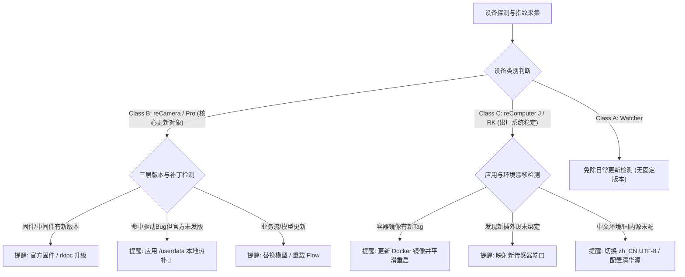
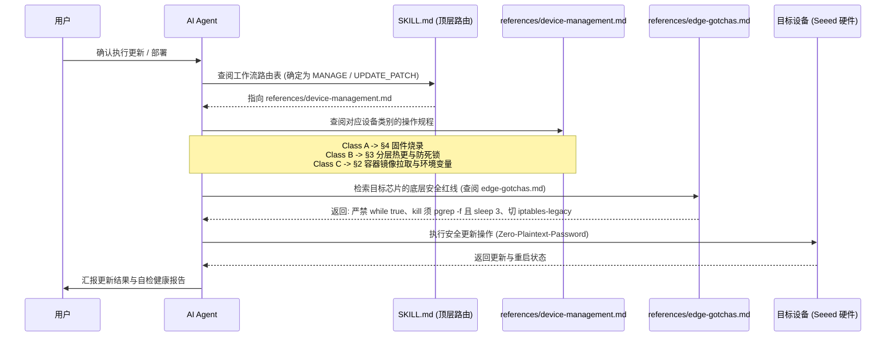

# 设备生命周期、分层更新与参数管理手册 (Device Lifecycle & Patch Management Guide)

> **定位**：供 AI Agent 在用户处于 **设备管理（MANAGE）**、**系统更新与打补丁（UPDATE_PATCH）**、**切换系统语言/镜像** 或 **参数热配（RECONFIG）** 阶段查阅。
> 当用户询问“怎么升级”、“打个补丁”、“切换语言”、“换应用镜像”、“改一下 MQTT 地址”、“插了新硬件怎么配”时加载本手册。

---

## 0. 核心架构：出发点与触发时机分化 (Trigger Paradigm & Architecture)

设备更新与应用修改的**出发点与触发时机截然不同**，Agent 必须严格遵守以下时序分化原则：

| 维度 | 设备级底层更新 (Device-Level / Firmware / BSP) | 应用层业务修改 (Application / Models / Reconfig) |
|---|---|---|
| **核心出发点** | **筑牢底层地基**：规避硬件死锁、驱动崩溃（如 VPSS FIFO overflow）与内核协议缺陷（如 Docker nftables 冲突） | **敏捷业务迭代**：满足模型换代、参数微调、业务流变更，保障系统连续运行零停机 |
| **触发时机** | **尽早主动提醒 (Early & Proactive Trigger)**<br>👉 设备刚连接、环境初次自检、准备部署前 (`ONBOARDING / PRECHECK`) | **按需被动响应 (On-Demand / Just-In-Time)**<br>👉 设备正常运行中，仅在用户提出具体业务改动时 (`MANAGE / RECONFIG`) |
| **交互行为** | **前置体检与拦截**：一旦发现底层固件版本过旧或存在已知驱动缺陷，主动打断并建议优先升级，避免部署中崩溃 | **零打扰按需加载**：平时静默，用户说“改一下 MQTT”、“换个检测模型”时才定向查阅对应章节，局部热更并秒级生效 |

---

### 0.1 设备检测与硬件指纹提取
当用户接入设备、发起环境自检或询问“当前设备状态”时，Agent 首先通过以下命令采集设备特征指纹：
```bash
solution-cli doctor --json
sensecraft-engine device scan
```
- **Class A 判定（MCU / Watcher）**：USB VID:PID 匹配 `303a:1001` (ESP32-S3) 或出现 USB-CDC 虚拟串口。*注：Watcher 目前无固定官方固件版本线，免除日常版本更新检测，仅在需要时进行全量固件刷写。*
- **Class B 判定（reCamera 与 reCamera Pro，重点核心）**：系统包含 `/userdata` 持久分区、轻量 Buildroot 系统、运行 `rkipc` 或 `sscma`，带有硬件 ISP/VPSS 节点。**这是分层更新与打补丁的核心对象！**
- **Class C 判定（reComputer 系列 / SBC）**：`uname -m` 为 aarch64，运行完整 Ubuntu/Debian，存在 Docker 守护进程与持久化大存储。
  - **reComputer Jetson（J 系列）**：读取 `/etc/nv_tegra_release` 识别实际 L4T/JetPack 版本（如 Orin 架构 J4012/J4011 搭载 JetPack 5.x/6.x，出厂预装 JP 6.x / L4T r36.x；Xavier 架构 J2012 搭载 JetPack 5.x / L4T r35.x，不支持 JP6）。底层系统稳定，不重装底层系统，按实际 JetPack 版本匹配容器与 CUDA 依赖；
  - **reComputer RK 系列（RK3588/RK3576）**：底层为稳定的 Linux 6.1.x 定制系统，目前无频繁大版本迭代。

### 0.2 如何检测设备是否需要更新？
Agent 执行**针对性校验模型**判定更新需求：



1. **针对 reCamera 与 reCamera Pro（更新与打补丁的核心对象）**：
   - **L1 固件层**：读取 `/etc/version` 与官方固件包版本对比；
   - **L2 中间件与服务层**：检查 `rkipc` / `sscma` 版本，以及是否受到已知驱动 Bug（如 VPSS FIFO overflow）影响；
   - **L3 应用与模型层**：对比 `/userdata/models/` 或 Node-RED Flows 是否有最新优化版本；
   - **本地热补丁需求**：若官方尚未发版但本地存在验证通过的修复（如 rkipc 优化版），主动提醒是否通过 `/userdata` 注入热补丁。
2. **针对 reComputer 系列（Jetson 出厂默认 JP 6.2，RK 底层稳定）**：
   - 底层系统不重装、不频繁刷机；
   - 检测运行中 Docker 镜像 tag/hash vs 方案 Catalog 最新镜像，若有新版本则提醒更新应用镜像；
   - 扫描当前外设列表，检查是否有新插入的传感器未绑定（如毫米波雷达串口）；
   - 检查系统环境（是否未配置中文 locale，国内网络下是否未配置镜像加速）。
3. **针对 Watcher**：
   - 暂无固定版本线，免除自动版本对比提醒。仅在用户明确要求刷写固件或恢复出厂时提供烧录支持。

### 0.3 主动提醒用户话术模板
当检测到需要更新时，Agent **必须结构化输出提醒并征得用户授权**：
> *“💡 设备状态与更新检测提醒：*
> *- **识别设备**：Seeed Studio reComputer J4012 (Orin NX)*
> *- **当前状态**：运行方案 `fall_detection` (v1.0.1)；检测到新插入硬件 `/dev/ttyUSB1` (毫米波雷达)*
> *- **建议更新**：*
> *  1. 官方已发布 `v1.1.0` 镜像，优化了暗光下人体姿态估计帧率并修复了内存泄漏；*
> *  2. 建议将新增的毫米波雷达串口映射到容器中，以提升私密防跌倒感知精度；*
> *  3. 建议将系统默认语言配置为 `zh_CN.UTF-8`。*
> *预计耗时约 2 分钟，更新期间不会丢失历史录像数据。是否同意立即执行更新？[立即更新 / 稍后处理]”*

### 0.4 Agent 在修改对应设备时如何查阅本 Skill？
当用户确认更新后，Agent 按照**渐进式路由规约**查阅并执行操作：



1. **第 1 步：查阅 `SKILL.md` 顶层路由表**：
   - 匹配 Intent：`MANAGE / RECONFIG` ➔ 明确加载 `references/device-management.md`；
2. **第 2 步：按设备类别查阅具体操作章节**：
   - 若目标设备是 **Class A (SenseCAP Watcher)** ➔ 查阅 `§4` 固件刷写指令；
   - 若目标设备是 **Class B (reCamera 系列)** ➔ 查阅 `§3` 分层更新方案（区分 L1 固件、L2 中间件、L3 模型/Flow）；
   - 若目标设备是 **Class C (reComputer 系列)** ➔ 查阅 `§2` 容器 Compose 更新与 locale 切换；
3. **第 3 步：横向查阅排障红线 (`references/edge-gotchas.md`)**：
   - 在执行重启或启动前，Agent 必须对照 `edge-gotchas.md` 中对应芯片的避坑卡（例如：操作 reCamera 时核对 Card 2/3，禁止死循环保活；操作 RK3576 时核对 Card 1，检查 iptables-legacy 是否配置）；
4. **第 4 步：执行并在失败时调用自愈**：
   - 若遇到部署与更新异常，查阅 `references/diagnose.md` 执行最多 3 轮最小改动本地修复；成功后生成脱敏 GitHub 建议回流。

---

## 1. 三类设备的生命周期与更新模型

边缘硬件形态各异，更新与打补丁的机制必须严格按设备类别区分，切忌混淆：

| 设备类别 | Seeed Studio 官方产品 & 代表硬件 | 系统架构特征 | 官方升级机制 | 本地小补丁 / 快速热替换 (Local Hotpatch) | 回滚与安全守护 |
|---|---|---|---|---|---|
| **Class A: MCU / 纯固件设备** | **Seeed Studio SenseCAP Watcher**、ESP32 系列、Himax WE2 | 裸机 / FreeRTOS，无独立用户态文件系统 | **全量固件刷写**<br>(USB-CDC / OTA Flash Binary) | **不支持分层热更**：必须在源码重编后重新烧录完整镜像 | 串口烧录校验 (CRC/MD5)；OTA A/B 分区回退 |
| **Class B: 轻量嵌入式 Linux 多层设备** | **Seeed Studio reCamera** (SG2002)、**reCamera Pro** (RV1126B) | Buildroot/OpenWrt，只读 RootFS + 持久化分区 (`/userdata` 或 `/app`) | **分层 OTA 固件更新**<br>(Kernel + RootFS + 原厂 BSP) | **分层热更与局部覆盖**：<br>1. 底层驱动小补丁：`/userdata` 启动脚本 bind mount 覆盖；<br>2. 管道与服务热更：在 `/userdata` 替换自编译 rkipc/sscma；<br>3. 上层应用/模型更新：直接替换 `.cvimodel`/`.axmodel` 或 Node-RED Flow | **严禁死循环拉起进程**（防 Fork 风暴瘫痪用户态）；<br>杀进程一律用 `pgrep -f` 并在新起前 `sleep 3` 释放 VPSS 通道；<br>保留出厂 `.orig` 备份 |
| **Class C: 通用单板计算机 (SBC)** | **Seeed Studio reComputer J 系列** (J4012/J2012/Jetson)、**reComputer RK 系列** (RK3588/RK3576)、**reComputer R 系列** (Raspberry Pi CM4) | 通用发行版 (Ubuntu/Debian)，大存储，OCI/Docker 容器化生态 | **底层 OS 基本保持不变**，仅必要时执行 `apt update` | **声明式环境配置与容器生命周期**：<br>1. 环境适配：一键配置语言 locale、时区、清华/国内镜像源；<br>2. 应用镜像升级：通过 Docker Compose 切换镜像 Tag；<br>3. 业务配置更新：通过挂载卷 (Bind Mount) 传入 `.env` 或配置文件 | 容器 Healthcheck 探针；镜像 Tag 快速回滚；`iptables-legacy` 与 udev 规则保底 |

---

## 2. Class C: 通用 SBC 的环境配置与容器更新操作流

SBC 设备（RK3588 / RK3576 / Jetson / RPi）在出厂后系统基础镜像基本保持稳定，日常运维聚焦在**系统环境切换**与**应用容器升级**。

### 2.1 系统环境与默认语言 (Locale) 切换
当用户需要将系统语言切换为中文或英文，或校准时区与源时：
```bash
# 1. 切换/生成中文环境 (zh_CN.UTF-8)
sudo apt-get install -y locales
sudo locale-gen zh_CN.UTF-8 en_US.UTF-8
sudo update-locale LANG=zh_CN.UTF-8 LC_ALL=zh_CN.UTF-8
# 导出当前环境变量
export LANG=zh_CN.UTF-8
export LC_ALL=zh_CN.UTF-8

# 2. 时区校准
sudo timedatectl set-timezone Asia/Shanghai

# 3. 基础镜像源快速换国内镜像 (如需)
# pip
export PIP_INDEX_URL=https://pypi.tuna.tsinghua.edu.cn/simple
# HuggingFace
export HF_ENDPOINT=https://hf-mirror.com
```

### 2.2 应用容器镜像更新与切换 (Docker Compose)
当官方发布了新的应用镜像，或用户需要切换为特定测试镜像：
```bash
# 1. 进入方案实际运行目录（本地部署通常位于 ~/.sensecraft/deployments/<solution_id>/；远程 SBC 需根据方案定义进入对应远端工作目录，如 /home/<user>/<workdir>/）
cd <deploy_workdir>

# 2. 检查当前运行的镜像版本
docker compose images

# 3. 拉取新镜像并平滑更新（零停机重构）
docker compose pull
docker compose up -d --remove-orphans

# 4. 验证容器健康状态
docker compose ps
docker compose logs --tail=50
```

---

## 3. Class B: reCamera 系列多层嵌入式设备的补丁与应用更新

reCamera 架构分为三层：**L1 固件与 OS 层**、**L2 中间件与流媒体层 (rkipc / sscma)**、**L3 应用与模型层**。

### 3.1 L3 上层应用与 AI 模型热更新 (秒级生效)
针对 Node-RED 业务流或目标检测模型文件的更新，不需要重启设备，也不动底层固件：
1. **传输新模型到持久化数据区**：
   ```bash
   scp my_model.cvimodel admin@<device_ip>:/userdata/models/
   ```
2. **通知流媒体服务重载或重启轻量业务进程**：
   ```bash
   ssh admin@<device_ip> "curl -s -X POST http://127.0.0.1:8080/api/model/reload -d '{\"model\": \"/userdata/models/my_model.cvimodel\"}'"
   ```

### 3.2 L2 中间件服务热替换与补丁测试

当官方发布了中间件二进制修复补丁，或用户需要替换自编译版本：

#### (A) reCamera Pro (RK3576)：基于 ADB 传输与 /oem/usr/bin/rkipc
> ⚠️ **注意**：reCamera Pro 官方固件无 SSH root 权限，**标准通信通道为 ADB**。原厂二进制位于 `/oem/usr/bin/rkipc`。
```bash
# 1. 备份原厂二进制
adb shell "cp /oem/usr/bin/rkipc /userdata/rkipc.orig"

# 2. 推送自编译二进制到 /userdata（持久可写分区）并赋予执行权限
adb push ./build/rkipc /userdata/rkipc.patch
adb shell "chmod +x /userdata/rkipc.patch"

# 3. 严格遵循安全停止与重启规范（防 VPSS 崩溃）
adb shell << 'EOF'
for p in $(pgrep -f rkipc); do kill -9 $p; done
sleep 3 # 关键：等待 3 秒彻底释放 VPSS / VI 硬件通道
/userdata/rkipc.patch -c /userdata/rkipc.ini &
EOF
```

#### (B) reCamera (SG2002)：基于 SSH 传输与 /usr/bin/sscma
```bash
# 1. 备份原厂二进制
ssh admin@<device_ip> "cp /usr/bin/sscma /userdata/sscma.orig"

# 2. 部署自编译二进制到 /userdata 并赋予执行权限
scp ./build/sscma admin@<device_ip>:/userdata/sscma.patch
ssh admin@<device_ip> "chmod +x /userdata/sscma.patch"

# 3. 安全重启服务
ssh admin@<device_ip> "killall sscma; sleep 2; /userdata/sscma.patch &"
```

> [!CAUTION]
> **严禁在脚本中使用 `while true; do ...; sleep 1; done` 监控拉起进程**！若新二进制存在参数缺陷快速闪退，会造成整机 **Fork 暴风**，耗尽内核 PID，导致 SSH/HTTP/ADB 全瘫痪，只能拔电源。

### 3.3 L1 底层固件更新
- 固件升级涉及内核、U-Boot 与根分区，必须通过官方 OTA 包或 `sysupgrade` 工具整体升级；
- 若官方尚未发版，但需修补特定 kernel module（如驱动补丁），在 `/userdata/init.d/` 编写挂载脚本，系统启动时通过 `mount --bind` 将补丁 `.ko` 覆盖到 `/lib/modules/`。

---

## 4. Class A: MCU / 纯固件设备 (Watcher / ESP32) 更新

Watcher 等设备属于单片机架构，无操作系统与文件系统抽象：
1. **固件编译与生成**：在本地完成完整固件二进制构建。注意：**写入 `0x0` 地址必须是包含 bootloader、partition table 和 app 的合体固件（merged-bin）**；如果是独立的 app-only 二进制，严禁刷写到 `0x0`（否则会破坏 bootloader 导致变砖），必须按照分区表偏移量（如默认 app 分区 `0x10000` 或设备配置中声明的 offset）进行刷写。
2. **烧录接入**：通过 USB 连接，利用烧录工具刷写（以已合并的全量固件为例）：
   ```bash
   esptool.py --chip esp32s3 -p /dev/ttyUSB0 -b 921600 write_flash 0x0 watcher_firmware_merged_v1.2.0.bin
   ```
3. **固件重置**：遇到配置错乱时，先全量擦除再烧写：`esptool.py erase_flash`。

---

## 5. 运行时参数可修改性的分层边界

| 层级 | 参数类别 | 判断依据 | 处理方式 |
|---|---|---|---|
| **L1: 声明式热配参数** | 业务高频参数（MQTT Broker 地址、API Key、告警 Webhook、Wi-Fi 凭证） | 方案中声明了 `user_inputs` 且标记为 `reconfigurable: true` | **在线热修改**：直接调用设备管理 API 更新，后台自动重载并重启容器，零停机重装。 |
| **L2: 方案编排层参数** | 内部端口映射、Docker 数据卷挂载路径、未暴露的环境变量 | 仅存在于 `docker-compose.yml` 或 `devices/<id>.yaml` 中 | **方案级本地补丁**：走本地 auto-patch 流程，用 `--solutions-dir` 重新加载。 |
| **L3: 业务源码与算法层** | 模型置信度硬编码、状态机转移逻辑、前端 UI 界面组件 | 代码直接写死在 Python/C++/Vue 源码中 | **源码二次开发**：走 GitHub 克隆与本地构建联调流（查阅 `references/secondary-development.md`）。 |

---

## 6. L1 声明式热配标准操作流

当设备已经部署运行，用户希望修改 L1 参数（如更改 MQTT 目标服务器）时：

> ⚠️ **前置依赖**：在线配置热配端点依赖 SenseCraft 桌面客户端（FastAPI 后端提供），独立 `sensecraft-engine` 命令行暂不支持。请先核对桌面 App 运行状态与契约版本（需 `contract_version >= 6` 且 `python_backend` 非空，参见 `references/app-only.md` §1）。

### 步骤一：获取运行时信息与当前部署列表
```bash
RUNTIME=~/.sensecraft/runtime.json
[ -f "$RUNTIME" ] || { echo "未检测到运行时文件，请先启动 SenseCraft 桌面客户端"; exit 1; }
PYTHON_BACKEND=$(jq -r '.python_backend // empty' "$RUNTIME" 2>/dev/null)
[ -n "$PYTHON_BACKEND" ] || { echo "当前仅运行独立 Engine，热配端点需要 SenseCraft 桌面 App，请启动桌面客户端"; exit 1; }
CONTRACT_VER=$(jq -r '.contract_version // 0' "$RUNTIME" 2>/dev/null)
[ "$CONTRACT_VER" -ge 6 ] || { echo "当前桌面 App contract_version < 6，不支持在线配置修改，请升级 App"; exit 1; }
BASE_URL=$(jq -r '.base_url // "http://127.0.0.1:3260"' "$RUNTIME")
curl -sf "$BASE_URL/api/health" > /dev/null || { echo "SenseCraft App 服务未就绪"; exit 1; }
curl -s "$BASE_URL/api/device-management/active"
```

### 步骤二：读取可配参数及当前值（Get Config）
```bash
# 本地 Docker 部署实例
curl -s "$BASE_URL/api/docker-devices/local/config/<solution_id>"
```

### 步骤三：验证并提交新参数（Update Config）
```bash
curl -s -X PUT "$BASE_URL/api/docker-devices/local/config/<solution_id>" \
  -H "Content-Type: application/json" \
  -d '{
    "values": {
      "mqtt_broker": "192.168.1.200",
      "mqtt_port": 1883
    }
  }'
```

---

## 7. 官方未发版时的“方案级本地热补丁 (Local Hotfix)”运维

当官方方案库尚未发布新镜像/配置，但现场亟需修补方案编排：

1. **提取官方运行态副本**：
   ```bash
   mkdir -p ./.sensecraft-work/solutions/<solution_id>
   cp -r ~/.sensecraft/content/solutions/<solution_id>/* ./.sensecraft-work/solutions/<solution_id>/
   ```
2. **应用最小补丁**：
   在 `./.sensecraft-work/solutions/<solution_id>/` 下直接修改 `docker-compose.yml` 或 `devices/<id>.yaml`。
3. **通过本地补丁源重新注入热重载**：
   ```bash
   sensecraft-engine deploy --params <params-file> --solutions-dir ./.sensecraft-work/solutions --replace-existing --yes --detach
   ```
   *(复用原部署请求 `--params` 文件以完整保留 preset、connection 及目标参数，并限制仅对目标设备重新部署)*
4. **回流官方**：验证无误后，遵循 `references/diagnose.md` §7 自动生成脱敏 GitHub Issue/PR 建议草稿。

---

## 8. 新硬件热插拔与变动自动提醒 (Hardware Drift Detection)

在设备运行期，用户常会给主机额外插上新配件（例如新接入了 USB 摄像头、毫米波雷达串口、4G 网卡模块、PCIe NPU 卡）：

1. **变动识别时机**：
   每当用户发起“设备自检”、“查看状态”或提到“我刚插上了新设备”时，Agent 执行探测：
   ```bash
   solution-cli doctor --json
   sensecraft-engine device ports
   ```
2. **与当前方案配置对齐对比**：
   - 检查已发现的硬件（例如新增的串口 `/dev/ttyUSB1` 或新增的视频节点 `/dev/video1`）；
   - 对比当前运行方案（从 `/api/docker-devices/local/config/<id>` 或部署 Lockfile 中记录的绑定端口）。
3. **主动提醒用户跟进绑定**：
   若发现硬件列表多出了未经绑定的设备，Agent **必须主动发起提醒并给出跟进方案**：
   > *“💡 硬件变动提醒：检测到主机新插入了设备 `/dev/ttyUSB1`（USB 串口外设）。当前运行中的方案未绑定该端口。*
   > *如果您希望接入该硬件，请告诉我，我可以帮您在配置文件中追加串口映射并重新加载服务生效！”*
