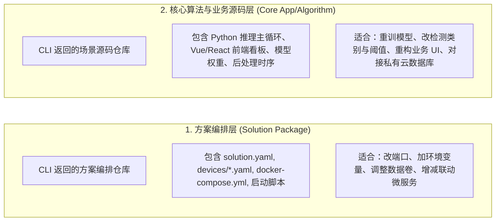

# 深度定制与源码二次开发手册 (Secondary Development & Source Customization Guide)

> **定位**：供 AI Agent 在用户处于 **深度定制（CUSTOMIZE）** 或 **源码二次开发（SECONDARY_DEV）** 阶段查阅。
> 当用户提出“我想改源码”、“替换成我自研的 YOLO 模型”、“前端页面想重新定制”、“GitHub 代码在哪里”、“克隆到本地开发”时加载本手册。

---

## 1. 方案开源代码的双层架构体系

Seeed SenseCraft 方案体系在 GitHub 上采用清晰的双层开源结构：



---

## 2. 源码检索与克隆指引 (Source Discovery & Clone)

### 动作一：获取方案官方仓库地址
使用 CLI 查询方案元数据：
```bash
solution-cli hub search "<方案名称或关键词>" --json
solution-cli hub get <reference-design-id> --section links --json
```
- 只使用 `hub get --section links` 返回并标明角色为 repository/source 的
  URL。不要根据 RD ID、落地页路径或 Wiki 路径自行拼接 GitHub、Wiki 或
  CDN 地址；没有声明仓库时明确说明源码地址未提供。

### 步骤二：克隆方案到本地工程目录
指导用户或在本地工作空间执行克隆：
```bash
# 方案编排包开发；将 CLI 返回的 repository/source URL 填入
git clone <declared-repo-url> ./my-solutions

# 或核心算法项目开发（以视觉推理为例）
git clone <declared-repo-url> ./my-model-assistant
```

---

## 3. Agent 协同开发与本地联调闭环 (Dev Loop)

克隆到本地工程后，Agent 可以作为用户的协同编程伙伴（Pair Programmer）深入代码：

### 阶段 1：代码与模型定制（Agent Coding）
- **模型替换**：
  - 用户训练好的私有权重（如 `custom_yolo11.onnx`），通过对应板卡工具链编译为目标格式（RKNN 板卡生成 `.rknn`，Jetson 生成 `.engine`，Hailo-8 生成 `.hef`）；
  - 将模型文件放入方案对应目录或通过卷挂载映射到容器内。
- **业务逻辑与看板调整**：
  - 修改检测状态机阈值、报警触发条件、Webhook 发送格式；
  - 修改 Web 监控界面组件。

### 阶段 2：引擎本地热加载联调（Local Engine Dev Loop）
修改完成后，无需打包推送到 CDN，直接利用 `sensecraft-engine` 的 `--solutions-dir` 特性在本地无缝验证：

```bash
# 从本地自定义工程目录加载方案并执行部署测试
sensecraft-engine deploy <id> --solutions-dir ./my-solutions/solutions
```
- 引擎将直接读取本地工程中的 `solution.yaml`、`devices/*.yaml` 和 `docker-compose.yml`，秒级完成本地部署生效。

### 阶段 3：代码固化与共享
- 本地验证通过后，指导用户：
  - 提交并推送到用户自己的私有 GitHub 仓库长期维护；
  - 若为通用改进，欢迎向官方开源仓库提起 Pull Request。

---

## 4. 自然交互与应答守则

1. **主动提供溯源**：当用户明确表达“想要改底层逻辑”、“换自研模型”时，主动告诉用户代码所在，并给出克隆建议。
2. **语气自然诚恳**：
   - 示例：“*先执行 `solution-cli hub get <rd-id> --section links --json`，我会使用返回的已声明源码链接。确认仓库地址后，再克隆到本地并按方案文档联调。*”
