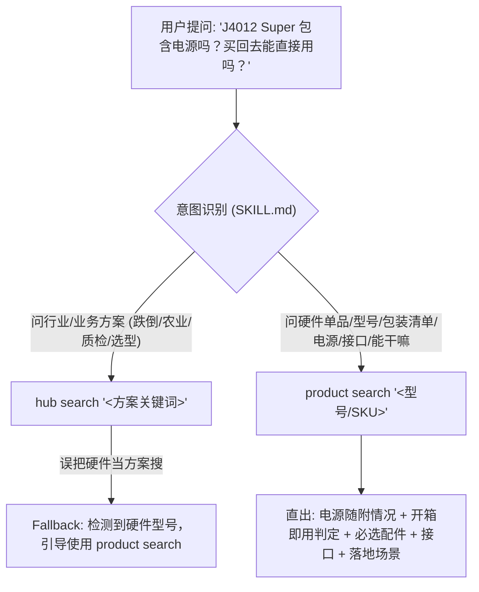

# Solution CLI

This skill drives the `sensecraft-engine` execution engine and `solution-cli` toolset. It operates across the complete lifecycle: **Solution Consultation ➔ Hardware & Accessory BOM Selection ➔ Local Deployment ➔ Self-Healing Diagnostics**. For Engine-only operations, use the injected absolute Engine path. If the wrapper is not on `PATH`, invoke the CLI as `npx -y --registry=https://registry.npmjs.org/ --package=@seeed-studio/solution-cli@latest solution-cli <args>`. Keep catalog queries such as `hub` and `product` on `solution-cli`; do not forward them to the Engine.

## Catalog model and production pages

Treat the catalog as a graph with distinct content types. A **Scenario** is a
business landing page. It owns links to one or more **Tech** pages and/or
**Reference Designs (RDs)**. A Tech page is an independently published
technology or ownership page; it is not a Wiki page and must not be inferred
from an RD. An RD is the concrete design that can contain architecture,
products, and a deployment mapping. A deployable RD maps to the executable
deployment document and presets exposed by the Engine; a website RD without
that mapping remains informative and is not deployable.

Use the catalog commands progressively:

```bash
solution-cli hub list --type scenario --locale <en|zh|ja> --page 1 --limit 50 --json
solution-cli hub get <id> --locale <en|zh|ja> --section overview --json
solution-cli hub get <id> --locale <en|zh|ja> --section links --json
solution-cli hub get <id> --locale <en|zh|ja> --section architecture --json
solution-cli hub get <id> --locale <en|zh|ja> --section products --json
solution-cli hub get <id> --locale <en|zh|ja> --section playbook --json
solution-cli hub get <id> --locale <en|zh|ja> --section integration --json
solution-cli hub get <id> --locale <en|zh|ja> --section cases --json
solution-cli hub get <id> --locale <en|zh|ja> --section deployment [--preset <id>] --json
```

## Device discovery, health pre-check, and self-healing

The CLI provides dedicated `device` subcommands to discover connected hardware, probe runtime environments, and remediate known hardware/network gotchas (e.g. USB Option 3 gateway hijacking PC connection, stale clocks, supervisor conflicts):

```bash
# 1. Discover connected devices (USB serial, ADB, default RNDIS)
solution-cli device scan [--json]

# 2. Inspect target device runtime profile (OS, arch, kernel, supervisor version)
solution-cli device inspect [--target recamera] [--host <ip>] [--json]

# 3. Run actionable Gotcha pre-flight checks (produces healthy/affected/error status)
solution-cli device check [--target recamera] [--host <ip>] [--only <gotcha_id>] [--json]

# 4. Remediate detected issues (supports --dry-run and explicit confirmation --yes for disruptive changes)
solution-cli device fix [--target recamera] [--host <ip>] [--only <gotcha_id>] [--dry-run] [--yes] [--json]
```

### Self-healing protocol for Agents:
1. When a user reports connection loss after plugging in a reCamera, run `solution-cli device fix --target recamera --only recamera_usb_gateway` to suppress DHCP Option 3 gateway broadcast.
2. Before deploying a solution, run `solution-cli device check --target <chip>` to verify runtime readiness.
3. For disruptive remedies (restarting Docker or altering firewall/network settings), inspect with `--dry-run` first or pass `--yes` when authorized.

For a catalog-wide request, page through `hub list` until `has_more` is
false. For a specific request, search first, then use `hub get` on the chosen
IDs. For links, call `hub get --section links`; do not scan manifests or write
an ad-hoc parser. `hub get --section links` returns the production landing
mapping for all three locales when published, plus separately declared Wiki,
repository, and document links. The verified landing hosts are:

| Locale | Production host |
|---|---|
| English (`en`) | `www.seeed.cc` |
| Chinese (`zh`) | `www.seeedstudio.com.cn` |
| Japanese (`ja`) | `www.seeed.co.jp` |

The path and availability must come from the CLI record. Do not construct a
Wiki route, CDN asset URL, or translated URL from an ID. A missing translation
may still have a published production route; report the returned content
locale/fallback separately. A catalog record is not proof that the local
Engine has the matching content: before deployment, read the actual Engine
`deploy-info` for the mapped solution ID.

A metadata or links response is not evidence that the content was read. When
the user asks what a solution does, how it is built, or which products it
uses, call `hub get` for the chosen `description`, `architecture`, or
`products` section and use that returned body. When a returned production page
or architecture image is material to the answer, open that exact returned
URL and state what was checked. When a solution includes an architecture diagram
(from `architecture_preview` or `hub get --section architecture`), present the
official architecture image to the user, render an editable Mermaid flowchart
based on its topology summary, and offer to customize the topology. A relative asset
path is usable only when the matching signed local content is present; otherwise
report the source asset as unavailable instead of treating the URL as an image that
has been reviewed.

## Workflow Routing & Intent Classification



Do NOT read all reference files at once. Determine the user's workflow state and intent, then execute the corresponding command and load **at most ONE** reference file on demand:

| User State & Intent | Reference to Load | Primary CLI Tool to Call | Guardrails & Forbidden Actions |
|---|---|---|---|
| **HARDWARE_SPEC / BOX_CONTENTS / POWER_READINESS**<br>“J4012 Super 包含电源吗？”、“盒子里有什么”、“带不带电源”、“买回去能否直接用/能否开箱即用”、“发货清单”、“有哪些接口”、“能干嘛” | `references/hardware-bom.md` | `solution-cli product search "<型号/SKU/关键词>" --json` | **STRICT HARD REDLINE**: 严禁凭常识臆测硬件包材（如擅自推测 Super 版本带电源）或谎称没有清单。包装随附情况、电源线适配器状态、开箱即用性必须严格以 `product search` 返回的 `package_profile`、`package_contents` 和 `interfaces` 为准！回答“设备能干嘛”直接使用返回的 `supported_scenarios`。 |
| **DISCOVERY / CONSULT**<br>“我想做防跌倒监控”、“有智慧农场方案吗”、“怎么做园区安防” | `references/consult-and-select.md` | `solution-cli hub search "<keyword>" --json`, then `hub get <id> --sections architecture,playbook --json` | **DO NOT run deploy**; search exposes `available_sections` and evidence status (`documented`/`generic`/`inferred`). 若返回 warning 提示包含硬件关键词，立即按提示切换至 `product search`。 |
| **PROCUREMENT / VERIFY_BOM**<br>“买什么硬件？”、“J4012 需要配什么配件？”、“推荐镜头/天线” | `references/hardware-bom.md` | `solution-cli product accessories <id> [--category <power,camera>] --compact --json` | **DO NOT fabricate** third-party SKUs or prices. Always distinguish REQUIRED vs OPTIONAL accessories. Use `--compact` and `--category` to save tokens. |
| **ONBOARDING / PRECHECK**<br>“设备到了，插上了网线/USB”、“环境自检”、“发现新设备” | `references/diagnose.md` & `references/device-management.md#0` | `solution-cli doctor` / `sensecraft-engine device scan` | **Early & Proactive**: Check device firmware & drivers early. Intercept and prompt for reCamera firmware/patch or SBC env fixes before deploy. |
| **DEPLOYING / APPLY**<br>“开始安装”、“部署 fall_detection” | `references/deploy.md` | `solution-cli hub get <id> --section deployment --preset <id> --json` then `sensecraft-engine deploy <id> -i STEP.KEY=VAL` | **DEPLOYMENT CRITICAL SECTION**: Zero external commercial queries allowed during apply. Filter guide with `--preset` to reduce token bloat. Use `--input` / `--inputs-file` for parameters, `--replace-existing` to update containers. |
| **INTEGRATION / INGESTION**<br>“怎么接到我们系统”、“MQTT主题是什么”、“Webhook格式”、“接入 Home Assistant”、“有哪些接口/怎么读数据” | `references/device-management.md#7` | `sensecraft-engine schema <id> --json` or `solution-cli hub get <id> --section integration --json` | **System Ingestion**: Inspect input schema and output data interfaces directly via `sensecraft-engine schema <id>`. Provide exact MQTT topics, payload schemas, Webhook endpoints, and port mappings directly from verified contract. |
| **MANAGE / RECONFIG**<br>“改一下 MQTT 地址”、“换模型/业务流”、“重启服务”、“修改配置”、“打本地补丁”、“换应用镜像” | `references/device-management.md` | `curl BASE/api/docker-devices/local/config/<id>` / `solution-cli doctor` | **On-Demand (JIT)**: Only query when user requests application-layer modifications. Apply tiered hotpatches without touching underlying OS. |
| **FEASIBILITY / SALES_EVAL**<br>“我们能不能做这个？”、“非标需求评估”、“需求匹配度如何”、“做这个要多久” | `references/sales-feasibility.md` | `solution-cli hub search "<keyword>" --json` / `product query <family>` | **DO NOT make blind promises**. Strictly follow the 4-tier feasibility matrix and scoring criteria. |
| **CUSTOMIZE / SECONDARY_DEV**<br>“我想改源码”、“换成自研模型”、“改前端看板”、“GitHub 仓库” | `references/secondary-development.md` | `git clone <repo_url>` / `sensecraft-engine --solutions-dir` | **Never edit cached content**: Clone to user workspace, pair-program, test locally with `--solutions-dir`. |
| **EDGE_GOTCHAS / HARDWARE_DEBUG**<br>“3576/3588编译报错”、“/dev/rknn打不开”、“recamera崩溃”、“VPSS overflow”、“fork风暴”、“高卡/踩坑” | `references/edge-gotchas.md` | `solution-cli gotchas "<keyword>" [--chip <chip>] --json` / `dmesg \| grep -i -E "rknpu\|vpss\|fifo\|oom"` | **Brand-agnostic**: Focus on generic 3576, 3588, reCamera, reCamera Pro, and MCU gotchas and hardware traps. |
| **TROUBLESHOOTING**<br>“部署报错”、“黑屏”、“无视频流” | `references/error-catalog.md` | `sensecraft-engine logs` / `solution-cli gotchas "<symptom>" --json` | Max 3 fix-and-retry rounds. Follow local auto-patching rule. |

### Progressive Disclosure & Multi-Section Fetch
During discovery, `hub search` returns records with `available_sections` and their status (`section_status`: `documented`, `inherited`, `generic`, `inferred`).
Instead of multiple roundtrips, retrieve multiple sections at once:
`solution-cli hub get <id> --sections architecture,integration --json`
To retrieve single sections:
- `overview`: basic metadata, tags, and progressive directory navigation
- `links`: landing pages, wiki, repo, and declared documents
- `description`: deep solution background and functional breakdown
- `architecture`: modules, block diagrams, topology, and gallery
- `products`: bill of materials (BOM), required vs optional hardware
- `deployment`: deployment steps (use `--preset <id>` to filter and reduce token usage)
- `playbook`: field diagnostic questions and engineering rationales
- `cases`: customer case studies, deployed hardware list, region, and verified outcomes
- `integration`: system ingestion contracts (MQTT topics, Webhooks, REST endpoints)

### Case Deep Dive & Product Pruning
When drilling down into specific case studies or hardware models:
- **Case Full Story**: Use `solution-cli case get <id_or_slug> [--locale zh|en|ja] [--json]` to retrieve complete Markdown body (`body_md`), deployment field background, and customer metrics.
- **Product Progressive Pruning**: When querying hardware with `product search` or `product query`, use `--section <overview|power|interfaces|specs|all>` to prune verbose JSON trees and save context tokens:
  - `--section power`: only returns `package_profile`, `power`, `required_accessories`, and `package_contents` (ideal for power adapter and box contents audits).
  - `--section interfaces`: only returns board interfaces, protocols, and I/O expansion ports.
  - `--section overview`: lightweight overview of family and model names.
  - `--section specs`: detailed hardware specifications and AI TOPS.

Capabilities that need the **SenseCraft Solution desktop app** (editing a
solution's configuration, the app's `/api/ai/context`, diagnosing through the
app's logs) are in `references/app-only.md`. Use them only when the user has
the app running.

## Host platform boundary

The standalone engine supports four host platforms: macOS ARM
(`aarch64-apple-darwin`), Linux ARM (`aarch64-unknown-linux-musl`), Linux
x86_64 (`x86_64-unknown-linux-musl`), and Windows x86_64
(`x86_64-pc-windows-msvc`). macOS x86_64 is not maintained; under Rosetta,
run the installer from a native ARM shell.

`docker_deploy` target `local` requires a supported Docker host. Windows native
`docker_local` is intentionally unsupported by both the Python and Rust
deployers; a Windows CLI can still use a `remote` target over SSH to a Linux
Docker host. WSL uses the Linux engine binary and Linux host behavior; do not
describe a WSL run as Windows-native local Docker support. USB device steps
remain hardware-dependent and require the user to connect and confirm the
device.

On macOS, local Docker uses the literal `docker` command found by the engine's
process environment. If Docker Desktop's CLI is only inside its application
bundle, start a new engine process with a temporary `PATH` containing that
bundle's `bin` directory; do not change global shell configuration or assume an
existing engine daemon inherits the new path. Verify the new engine instance
with `doctor --json` before selecting a local target. A running Docker Desktop
daemon is a host prerequisite, not evidence that a deployment has passed.

## Rules

1. **Credentials and secrets (Zero-Plaintext-Password):** NEVER ask the user to send raw passwords, API keys, or private tokens into the chat context (this triggers LLM safety refusal guardrails and risks credential leakage). Always prefer SSH Key-based authentication (defaulting to `~/.ssh/id_ed25519` or `~/.ssh/id_rsa`). If the remote target lacks key-trust, guide the user to run `ssh-copy-id -i ~/.ssh/id_ed25519.pub <user>@<host>` in their local terminal. Replace any echoed secrets with `<REDACTED>`. Never invent hosts or usernames.
2. **What you may do without asking, and what needs the user's OK:**

   | Action | Ask first? |
   |---|---|
   | Read deployment status and logs (`status`, `logs`), engine log files, `doctor`, `device list/ports/scan` | No |
   | Read-only checks on a device over SSH (`docker ps`, `docker logs`, `df -h`, `ss -ltnp`, `ping`) | No |
   | Edit the solution's edit copy (desktop app only, see `references/app-only.md`) | No — show the diff afterwards; the user sees it in the app as "locally modified" and can restore the official version in one click |
   | Anything a person does with their hands: plug in or swap a cable, connect a servo, sit in front of a camera, walk across a counting line, move or stand near a robot arm | **Yes** — tell the user what to do and wait for them to confirm it is done |
   | Commands that move hardware (`robot torque`, `robot actions test`) | **Yes** — the user confirms nobody is within reach first |
   | Change anything on a device: stop/remove containers, delete files, install packages, change system settings; `--replace-existing` | **Yes** |
   | Redeploy | First retry: no. Every later retry: **yes** |
   | Cancel a running deployment | **Yes** — it can leave a device half-configured |
   | Prepare an issue report (the user submits it) or open a pull request | **Yes** |

3. **At most 3 fix-and-retry rounds** per problem for deterministic failures
   (wrong parameter, missing file, port taken, bad credentials, a container
   that exits). After that, stop and give the user a report (what failed, what
   you checked, what you changed). Transient registry or network errors follow
   the backoff rule in `references/deploy.md` §6 and do not use up a round.
4. **Preserving official cache & Local auto-patching**: Never edit files directly under the official content cache directory (`~/.sensecraft/content/`). When fixing a solution-level bug (timeout too short, wrong port/env var, minor syntax/transfer glitch, broken health check):
   - In CLI / Engine mode: copy the solution from `~/.sensecraft/content/solutions/<id>` into `./.sensecraft-work/solutions/<id>`, apply the minimal fix in that copy. Then re-run deployment with `sensecraft-engine deploy --params <params-file> --solutions-dir ./.sensecraft-work/solutions --yes --detach` (preserving the original preset, connection, and target parameters) so the engine picks up the patched files. Show the user the patch diff.
   - If running with the Desktop App: use the app's edit copy mechanism (`references/app-only.md` §4).
5. **Reading output:** read the CLI's JSON output directly; it is small. If a
   filter is needed, use `jq` only when it is already installed. Do not start
   python, node or any other interpreter to parse output. Where a command has
   a flag that prints just what you need (`--json`, `--preset`, `--device`,
   `--since`), use it.
6. **Temp files:** keep request bodies and scratch files in the current
   working directory under `./.sensecraft-work/`, never in `/tmp`. Remove the
   directory when the task ends, also after a failure.
7. **Conversational tone & soft referral:** Agent is an IoT domain expert and
   answers technical, business, hardware, and configuration questions directly
   and thoroughly using local knowledge and tools. Do NOT dump raw link lists
   or write pushy sales pitches. External links (`landing_url`, `wiki_url`,
   product purchase URLs, `repo_url`) must be smoothly integrated as
   supplemental reading / procurement / code exploration. Search and product
   results may include attribution parameters when the CLI adds them; links
   returned by `hub get --section links` are declared URLs and must be used as
   returned.
8. **Proactive diagnosis & domain-specific questioning:** During solution consultation,
   Agent must avoid one-way monologues. Use a returned `diagnostic_playbook` only
   when the selected search result actually contains one; otherwise use the
   domain matrix in `references/consult-and-select.md` §3 and label the questions
   as general engineering checks. Ask 2–3 targeted questions explaining the
   rationale (topology, asset reuse, power/cabling, inspection speed/materials).

## Step 0 — Install the engine and the solutions (when needed)

1. Check whether it is installed: `sensecraft-engine --version`. If the command
   is not found, also try `~/.sensecraft/bin/sensecraft-engine --version`
   (Windows: `%USERPROFILE%\.sensecraft\bin\sensecraft-engine.cmd`); the
   installer puts it there and prints the `PATH` line to add.
2. Before running an installer, check its local prerequisites. On Unix run
   `command -v curl || command -v wget`, `command -v sha256sum || command -v shasum`,
   `command -v tar`, `command -v jq`, and `command -v minisign`. If wget is the
   selected downloader, also require `wget --help | grep -- --compression` to
   succeed; otherwise stop because the CDN may return gzip content. On Windows
   PowerShell run `Get-Command irm`, `Get-Command Invoke-WebRequest`,
   `Get-Command Expand-Archive`, `Get-Command ConvertFrom-Json`, and
   `Get-Command minisign`. Windows uses PowerShell/.NET ZIP and JSON support;
   it does not require `tar` or `jq`. If any check fails, report the missing
   command and stop; do not install packages or start another interpreter.
   `minisign` is required to verify the signed release manifest; Unix `jq` is
   required by the shell installer to read it.
3. If it is not installed, install it together with the solutions (ask the user
   first, it downloads a program). If the user explicitly asks to upgrade or
   reinstall, use the same solution-cli command; do not reinstall on every
   deployment:

   **Recommended (Zero-friction via solution-cli, target the current Agent explicitly)**:
   ```bash
   npx -y --registry=https://registry.npmjs.org/ @seeed-studio/solution-cli@latest install --agent <current-agent-id> -y
   ```

   Fill `<current-agent-id>` with the actual host ID: `workbuddy`, `claude`,
   `codex`, `codebuddy`, or `antigravity`. The WorkBuddy example is:
   ```bash
   npx -y --registry=https://registry.npmjs.org/ @seeed-studio/solution-cli@latest install --agent workbuddy -y
   ```
   An AI agent must use its current host ID; Codex must not hardcode WorkBuddy.
   Use `npx -y --registry=https://registry.npmjs.org/ @seeed-studio/solution-cli@latest install` for interactive
   selection. When one or more Agents are detected, pressing Enter selects all
   detected Agents; entering the matching number selects one host. In
   non-interactive mode, `install -y` without `--agent` also selects all detected
   Agents when any are detected. If none are detected, these defaults still use
   the CLI's default target set; pass `--agent <agent-id>` to control the scope
   explicitly.

   **Routine Update & Skill Synchronization**:
   ```bash
   solution-cli update -y
   ```
   (Automatically checks signed stable Engine, increments content definitions with `content update`, and synchronizes skills for all managed agents).

   **Custom or Third-party Agent Extension**:
   ```bash
   solution-cli install --skills-dir <path> -y
   ```
   (Injects Solution CLI skills into any custom, internal, or proprietary AI Agent skill directory).

   The command checks the signed stable Engine on fresh and repeat runs, reuses
   an equal or newer local version, and upgrades an older one. It preserves
   modified/unregistered skills and protected symlinks. Add `--agent ...` for an
   explicit agent selection or `--engine-path <path>` for a valid custom pin.
   `--force` can re-download equal/older versions and overwrite existing skill
   files, including user modifications; use it only when that overwrite is
   intended. Protected external symlinks are not followed, and it never
   downgrades a newer discovered Engine. Automatic reuse/upgrade rules start with
   publicly published solution-cli 0.3.1. Latest/signature failure
   stops before writes; offline use requires a valid explicit local Engine path.

   **Fallback (Standalone shell script when Node.js is not present)**:
   ```bash
   curl --compressed -fsSL https://sensecraft-statics.seeed.cc/solution-app/engine/install.sh | sh -s -- --with-content
   ```

   If `curl` is unavailable but `wget` passed the prerequisite check, use the
   equivalent command:

   ```
   wget --compression=auto -qO- https://sensecraft-statics.seeed.cc/solution-app/engine/install.sh | sh -s -- --with-content
   ```

   Windows PowerShell:

   ```
   & ([scriptblock]::Create((irm https://sensecraft-statics.seeed.cc/solution-app/engine/install.ps1))) -WithContent
   ```

4. Solutions are downloaded separately from the engine:

   | Command | Does |
   |---|---|
   | `sensecraft-engine content status --offline --json` | Reads the local content store only; an empty store is a normal result with `installed: 0` and exit code 0 |
   | `sensecraft-engine content status --json` | Compares local solutions with the online list |
   | `sensecraft-engine content pull` | Downloads every solution (first run), or only `--solution <id>` |
   | `sensecraft-engine content update` | Re-downloads installed solutions that changed online |

   Run the offline status check before deciding whether content is installed.
   If it returns exit code 0 with `installed: 0`, run `content pull`; do not
   treat that status result as an error. A solution query such as `solution
   list` or `deploy-info` exits with code 3 when no usable resource/solution
   directory is available and tells you to run `content pull`. If a usable
   directory exists but the requested solution ID is unknown, the query exits
   with code 2. After `content pull` / `update`, newly downloaded or updated
   solutions are available to subsequent deployment and query commands.
5. Device pre-checks on this computer: `sensecraft-engine doctor --json`. Each
   check has `status` (`ok` / `warn` / `fail`) and a `fix` command. Show the
   user any `fail` and its `fix`; running a `fix` changes this computer and
   needs their OK.

Use `--lang zh` on commands that take `--lang` when the user writes in Chinese,
`--lang en` otherwise.

## Exit codes (all commands)

| Code | Meaning | Next step |
|---|---|---|
| 0 | Success / accepted | Continue |
| 1 | Deployment failed, cancelled or interrupted; for `counting` / `face` / `wizard` / `robot`: the device did not confirm | `references/diagnose.md` |
| 2 | Invalid arguments or request. A `missing_params` error includes `missing[]`; an unknown ID or malformed JSON is also code 2 and may have no `missing[]` | Ask for each field only when `missing[]` is present; otherwise inspect the ID, JSON shape and parameter spelling, then correct or ask for the specific value |
| 3 | Environment or conflict: a solution query has no usable resource/solution directory (`content pull`), device busy with another deployment (409), engine instance shutting down or incompatible, serial port busy | Read the message; pull content or fix the environment, then run again. An empty `content status --offline` store is exit 0, not this case |
| 4 | This step needs the desktop app (deployer not in the engine) | Tell the user to deploy this solution from the SenseCraft Solution app |
| 5 | Internal engine error | Engine bug: `references/diagnose.md` §6 |

## Pick the task

| The user wants to... | Read |
|---|---|
| Deploy a solution | `references/deploy.md` |
| Finish a step that reported `verify_required` (dashboards, counting lines, face enrollment, servo setup, robot arm) | `references/verify.md` |
| Find out why a deployment failed or a deployed solution misbehaves | `references/diagnose.md` |
| Deploy on a site without internet (prepare an offline package first) | `references/offline.md` |
| Change a solution's configuration, or use the desktop app's API | `references/app-only.md` (requires the desktop app) |

They connect: **a failed deployment goes straight to `diagnose.md`** without
stopping to ask; a `verify_required` event goes to `verify.md`; the retry goes
back to `deploy.md` for the failed device only.
