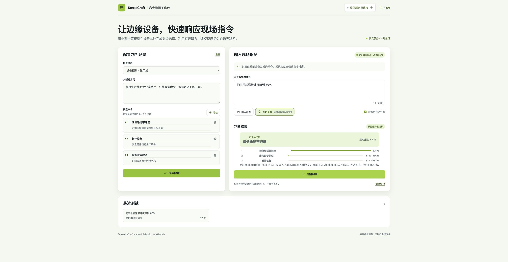
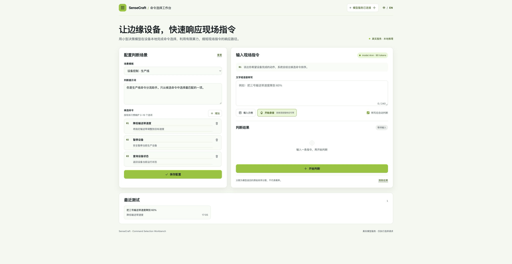

## 这个方案能帮你做什么

边缘设备命令工作台在本地浏览器中提供一个专注的操作界面：用户输入简短请求，应用从允许的候选命令中给出排序结果。模型和 tokenizer 运行在 RK3576 上，请求可以留在本地网络内。

## 核心价值

| 好处 | 具体说明 |
|------|----------|
| 保持请求本地处理 | 候选命令选择在 RK3576 上完成，不需要把请求发送到云端。 |
| 接入已有控制系统 | `POST /api/decide` 返回 JSON 选择结果和排序，可接入设备控制程序或网页应用。 |
| 限定可执行范围 | 由你的应用提供允许的候选命令，工作台只对这些选项排序，不生成不受控的任意命令。 |
| 保持边缘路径简洁 | 在已验证的 RK3576 环境中，对同一条 43-token 输入重复执行 120 次，total 延迟 p50 为 335.43 ms。这是延迟观察值，不是准确率结论。 |
| 按需连接语音 | 已有兼容的本地语音服务时可通过 `VOICE_SERVICE_URL` 连接；本方案不会自动安装语音服务。 |

## 适用场景

| 场景 | 怎么用 |
|------|--------|
| 输送带控制 | 提供“设置速度”“停止”“读取状态”等候选项，再为“把 3 号输送带降到 60%”排序。 |
| 工厂状态面板 | 让操作员用中文或英文短句选择“读取状态”动作。 |
| 机器人或网关接入 | 由已有控制系统发送候选列表，并读取 JSON 中的选中项。 |

## 使用须知

### 核心硬件设备

| 设备 | 说明 | 必需 |
|------|------|------|
| RK3576 Linux 设备，例如 LubanCat3 | 运行单容器 Web 工作台和 RKNN 模型 | ✓ 必选 |

现有已验证包面向 RK3576/RKNN。历史 `rk3576_remote` 套餐使用独立的 Laya/RKNN 0.1.0 路径，与当前 Kev RKLLM 套餐保持分离。RKLLM Kev 已在 reComputer RK3576 series RK3576 和 reComputer RK3588 series 完成设备验证：RK3576 部署请求限制为 2048 tokens，engine 导出容量为 8192；RK3588 部署上下文为 8192。应用 Docker 源中保留现有 Jetson TensorRT 部署；本方案介绍页不宣称 Jetson 原生 Kev 支持。

### 网络和存储要求

- 部署需要 SSH 访问目标设备。
- 目标文件系统至少保留 4GB 可用空间。
- 目标设备需要已有 Docker 和 `/usr/lib/librknnrt.so`。
- 容器不使用 `privileged` 模式，通过 RK3576 NPU DRM 节点、只读设备树路径和只读 RKNN 运行库挂载访问运行时。
- 首次部署会从配置的 HF endpoint 下载固定版本的归档、模型和 tokenizer，默认地址为 `https://hf-mirror.com`。

### Kev RKLLM 产物

- RK3576 和 RK3588 engine、FP32 Q/K head、tokenizer、metadata、RKLLM 1.3.1 runtime 与许可证说明均作为固定版本独立产物。
- 容器一次只加载一个本地模型系列。`MODEL_SERVICES_JSON` 可将另一模型系列指向已有 HTTP 服务，不会同时把两套模型加载到内存。
- Kev 套餐的已测设备与上下文限制见支持矩阵；这不代表同 SoC 的其他设备具有相同内存余量或无限上下文能力。

### 可选语音

只有提供已有兼容的本地语音服务时才可使用语音输入。本方案不会自动安装语音服务。浏览器麦克风访问需要 HTTPS 或 localhost。

## Kev QA 素材与支持矩阵

`gallery/kev-final/` 保存了 2026-10-11 reComputer RK3588 series 候选版本的中英文页面截图、pending 状态和截图剪辑。素材 SHA、服务地址、健康响应和请求元数据见 `gallery/kev-final/README.md` 与 `kev-final-evidence-20261011.json`。截图剪辑只表示页面步骤，不表示模型耗时、实时录屏或准确率。截图中的语音配置仅为可选项，未进行语音测试。

| 硬件/后端 | 当前状态 |
|---|---|
| RK3576 / RKNN Laya | 既有已验证路径 |
| RK3588 / RKLLM Kev | reComputer RK3588 series 已验证 8192 context、5 条 golden、超长输入错误和双模型 HTTP 切换；RKLLM 0.3.1 ef82 已发布 |
| RK3576 / RKLLM Kev | reComputer RK3576 series 500-case fixture：240 条中正确 189 条（78.75%）；部署限制 2048 tokens，engine 容量 8192 |

### 500-token 上下文 QA fixture

可复现的 context-500 fixture 保存在 [`assets/evidence/context500-20261011/`](assets/evidence/context500-20261011/)。其中包含 120 条 original 和 120 条 reverse case，每条 assembled input 固定为 500 tokens。冻结 dataset、metadata、runner、逐请求 JSONL、summary、日志和监测记录按设备保存。

| 设备 | 正确数 | HTTP 错误 | client p50 / p95 |
|---|---:|---:|---:|
| RK3576 reComputer RK3576 series | 189/240（78.75%） | 0 | 7115.31 / 7574.56 ms |
| RK3588 reComputer RK3588 series | 189/240（78.75%） | 0 | 3946.52 / 4770.96 ms |

该 fixture 使用生成的文档上下文将输入固定为 500 tokens。表中数据只表示冻结 fixture 的测量结果，不能外推到任意长工业请求，也不保证选中的动作安全。source、generator、dataset SHA、runner SHA 和设备绑定均记录在证据目录中。
| Jetson / TensorRT | 保留既有 TensorRT 路径；不宣称 Jetson 原生 Kev 支持 |

双模型切换的真实浏览器素材位于 `gallery/kev-final-switch/`：Laya 页面 chip/result 均显示 `rknn / 90 tokens`，Kev 页面 chip/result 均显示 `rkllm / 8192 tokens`。同一条英文指令分别通过下拉选择两个 profile；`Test and connect` 的真实 `GET /api/models` 返回 HTTP 200。素材说明了最终 UI 的可读性取整（score 三位小数、毫秒一位小数），raw API 数值保存在 evidence JSON 中。
