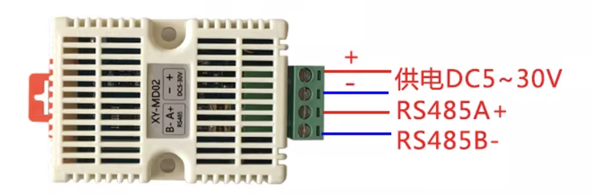

## 套餐: 工业 RS485 哑终端变智能对话终端 {#modbus_gateway}

把沉默孤立的工业 RS485 哑终端（如温湿度计、电表、三色报警灯或自备 485 设备）连接至 XIAO 核心板，一键写入网关程序，让哑终端开口说话，在 Home Assistant 智能大屏中实时呈现并建立自动化联动。

## 步骤 1: 部署编译环境 {#compiler type=docker_deploy required=true config=devices/compiler_host.yaml}

在本地电脑或远程 ARM64 边缘服务器（如 RK3576 / RK3588 / 树莓派）启动轻量编译服务，为后续自动生成专属硬件固件提供后台支持。

### 前置条件

- 目标机器为普通 ARM64 Linux 设备（如 RK3576、RK3588、树莓派等，4 核以上、4GB~8GB 内存）或本地电脑，无其他特殊硬件要求。
- 目标机器已安装并运行 Docker。
- 具备拉取容器镜像的网络连接。

### 部署目标 {#local type=local config=devices/compiler_host.yaml}

在这台电脑的 Docker 中启动编译服务。

### 部署目标 {#remote type=remote config=devices/compiler_host.yaml default=true}

通过网络将编译服务部署到远程设备。

### 故障排查

| 故障现象 | 解决措施 |
| --- | --- |
| 端口 6052 被占用 | 排查是否有其他服务正在使用该端口，或在配置文件中更换端口号 |
| Docker 守护进程未启动 | 启动 Docker Desktop 或运行 `sudo systemctl start docker` |

## 步骤 2: 填入配置并生成固件 {#builder type=script required=true config=devices/firmware_builder.yaml}

把 ESPHome YAML 发给编译服务生成固件。Wi-Fi、Modbus 地址和寄存器都写在这份 YAML 里。YAML 留空时编译方案自带的 XY-MD02 模板（本方案的 `assets/esphome/xy_md02.yaml`），烧录后板子会开出热点 “xiao-rs485-fallback” 用于配置 Wi-Fi。接入其他传感器时，把这份模板和传感器的 Modbus 寄存器表交给 AI 助手，回答它的问题（型号、地址、寄存器、Wi-Fi），把结果保存为 .yaml 文件并填写路径。

### 前置条件

- 步骤 1 的编译服务已成功启动并在 6052 端口运行。
- 可选：本机上自己的 ESPHome YAML 文件。

### 故障排查

| 故障现象 | 解决措施 |
| --- | --- |
| 无法连接编译服务 | 检查填写的 IP 地址是否正确，并确认目标设备的 6052 端口未被防火墙拦截 |
| 编译报错提示格式问题 | 检查配置代码中的 YAML 缩进格式（必须用空格缩进，不能用 Tab 键） |
| 提示 “ESPHome YAML not found” | 检查 YAML 文件路径，或留空使用自带的 XY-MD02 模板 |
| 板子连不上 Wi-Fi | 在 YAML 里填写 2.4 GHz Wi-Fi，或用手机连接热点 “xiao-rs485-fallback” 后在网页里设置 |

## 步骤 3: 烧录固件到网关 {#flasher type=esp32_usb required=true config=devices/xiao_rs485.yaml}

用 USB 数据线把 XIAO 网关板连到电脑，选择对应串口，一键把刚刚生成的固件写入设备。

### 前置条件

- Seeed Studio XIAO 核心板（C3 / S3 / C6）与配套 RS485 扩展板。
- 目标 485 传感器（如标配 XY-MD02 温湿度计，或用户自备的 485 设备）与 12V 供电电源。
- 一根支持数据传输的 USB Type-C 数据线。

### 接线

1. 把 RS485 扩展板插到 XIAO 核心板上。
2. 信号线：扩展板的 A+ 接传感器的 A+，扩展板的 B- 接传感器的 B-。
3. 共地线：扩展板的 GND 接传感器的 GND。
4. 电源线：12V 电源正极接传感器 VCC，负极接传感器 GND（与扩展板共地）。
5. 接线口诀：红电、黄正、黑负、绿地；A 接 A，B 接 B。

### 故障排查

| 故障现象 | 解决措施 |
| --- | --- |
| 电脑未识别到串口设备 | 重新插拔 USB 数据线，确认线缆支持数据传输，并检查串口驱动 |
| 写入超时或无法连接芯片 | 按住开发板上的 BOOT 按钮的同时重新插入 USB 数据线即可恢复 |

## 步骤 4: 在智能看板查看数据 {#dashboard type=web_dashboard verify=true required=true config=devices/ha_dashboard.yaml}

打开 Home Assistant 控制台，确认网关已被系统自动发现，并在大屏上看到实时温湿度数据卡片。

### 前置条件

- 局域网内已部署好 Home Assistant 系统。
- 网关设备已接入局域网 2.4 GHz Wi-Fi。

### 故障排查

| 故障现象 | 解决措施 |
| --- | --- |
| 设备未在通知中自动弹出 | 确认 Home Assistant 与网关设备连接在同一个路由器的局域网内 |
| 数据显示为空或没有刷新 | 检查传感器 12V 供电是否正常，检查 A+/B- 信号线是否接反 |

### 部署完成

部署全部完成！传统工业设备已成功唤醒，传感器数据正持续同步至 Home Assistant，你可以直接在仪表盘上创建联动自动化规则。
