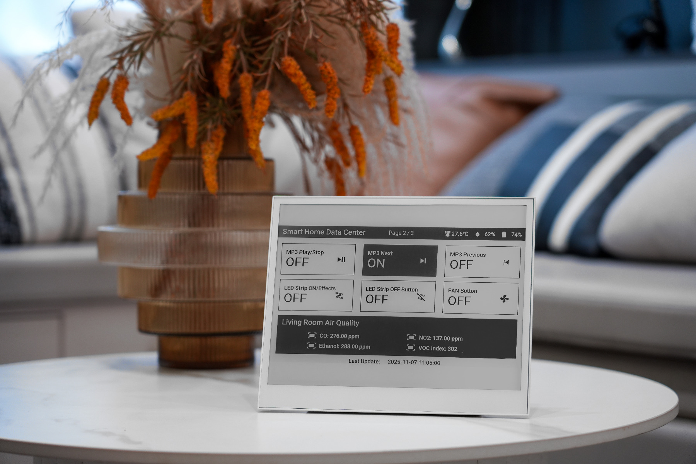
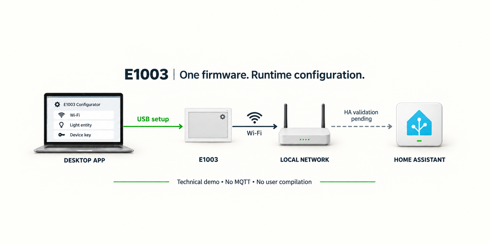

# E1003 统一部署技术演示

在桌面 App 同一表单选择设备并填写灯光设置，App 自动检查固件、按需安装 0.2.0，再保存配置。**默认无需 API 密钥，加密可选**；设备已有可用 Wi-Fi 时可直接复用，无需事先保存本机密钥记录，也无需编译或编辑 `secrets.yaml`。

**已验证：** 打包后端与桌面共享前端实际完成 0.1.0→0.2.0 升级、复用网络、清除旧加密、保存 65 秒、复位和免密目标读回。本次并非原生窗口提交验收；十分钟后复查、新 Wi-Fi 表单、实机触摸、真实 HA 控灯及屏幕同步仍待验收。

## 演示中得到什么

- 同一份预编译固件，固定显示时钟、温湿度和灯光卡片。
- 默认免 API 密钥的配置与读回；如需加密，可在表单勾选，完成后才显示密钥复制按钮。
- 复位后保留的灯光绑定，以及 App 内的检查、安装和保存进度。

固件只为灯光开关与 25%、50%、75%、100% 亮度定义了五个触摸区，共用“按钮控制的灯”。其它图形没有点击绑定；这不表示触摸或真实控灯已验收。

## 产品实物与连接结构

照片来自 Seeed 官方产品页。屏幕是官方展示界面，并非本固件的布局或实机验收画面。

USB 用于设备识别与配网；App 通过局域网写入灯光绑定并读回。图中的 **Device key 为可选加密能力**，默认不需要。图为生成示意，HA 控灯与状态同步仍待验收。

## 如何测试

1. 连接 USB，在 App 选择串口并填写“按钮控制的灯”，如 `light.bedroom`。已有网络时 Wi-Fi 留空；首次联网时填写名称和密码。
2. 默认不勾选 **启用 API 加密（可选）**，点击 **部署并保存配置**。App 按项目标识、版本和硬件检查固件，匹配则跳过，否则校验镜像后安装。
3. 保持供电直到 65 秒保存、复位和读回通过。默认模式在 Home Assistant 直接确认设备；只有启用加密时才复制密钥。允许设备执行 HA 动作后，再单独验证五个触摸区。

## 接口与条件

使用 Improv Serial 与 ESPHome 原生 API（TCP 6053），无需 MQTT 或设备网页服务。API 默认不加密，可选择启用；电脑、设备与 HA 需在同一可达局域网。

仅支持 E1003 当前固定布局和 USB 更新，不支持 OTA。任意灯的状态与亮度同步仍需 HA Blueprint 或适配。

> 正式技术演示候选仍禁用，等待公开 contract 13 和固件下载资源。原生窗口已确认加密默认未选且无密钥复制按钮；本轮完整升级与配置证据来自打包后端和共享前端。

原生实现见 [App 草稿 PR #162](https://github.com/suharvest/app_collaboration/pull/162)。
