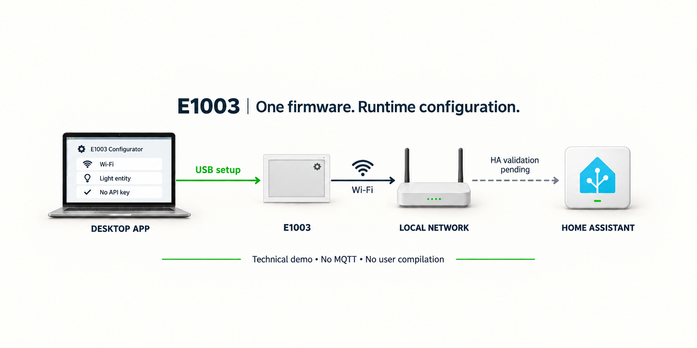

# E1003 灯光面板配置演示

连接设备，填写要控制的灯。App 会自动检查并按需安装固件。

这是一个技术演示：在同一表单配置灯光绑定，无需编译、编辑配置文件或填写 API 密钥。

## 可以测试什么

- 为 E1003 指定一盏 HA 调光灯。
- 查看配置保存、重启和读回结果。
- 保存成功后，接入 HA，再验证面板控灯。

仅灯开关和 25%、50%、75%、100% 亮度五个区域定义了触摸动作，其它图形没有点击绑定。实际触摸、HA 控灯与屏幕同步仍待验收。

## 设备与连接

官方照片中的界面不是本固件的验收画面。

USB 用于检查设备与配网，局域网用于写入设置和读回。封面是生成示意，不代表实机控灯已通过。

技术详情与验证状态

参考固件为 0.2.1，固定 plaintext-only；无 API 加密选项或密钥复制入口。使用 ESPHome native API（TCP 6053），无需 MQTT 或设备网页服务，仅支持 USB 更新。

固件和软件检查已通过，最终真机上传尚未开始；不把旧版本的免密结果算作本版验收。墨水屏断电留图不证明触摸电路有电。

正式候选仍禁用，等待公开 contract 14、兼容 App 分发、固件下载 URL 和实机验收。开发者固件独立保留加密。任意灯的屏幕状态与亮度同步仍需 HA Blueprint 或适配。

