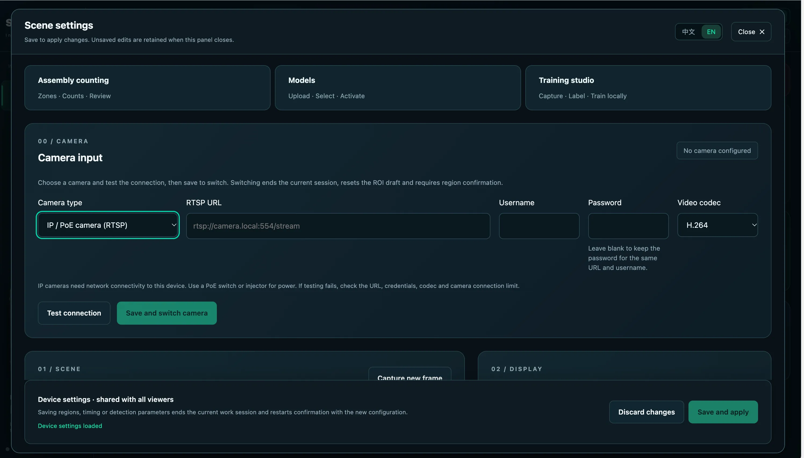
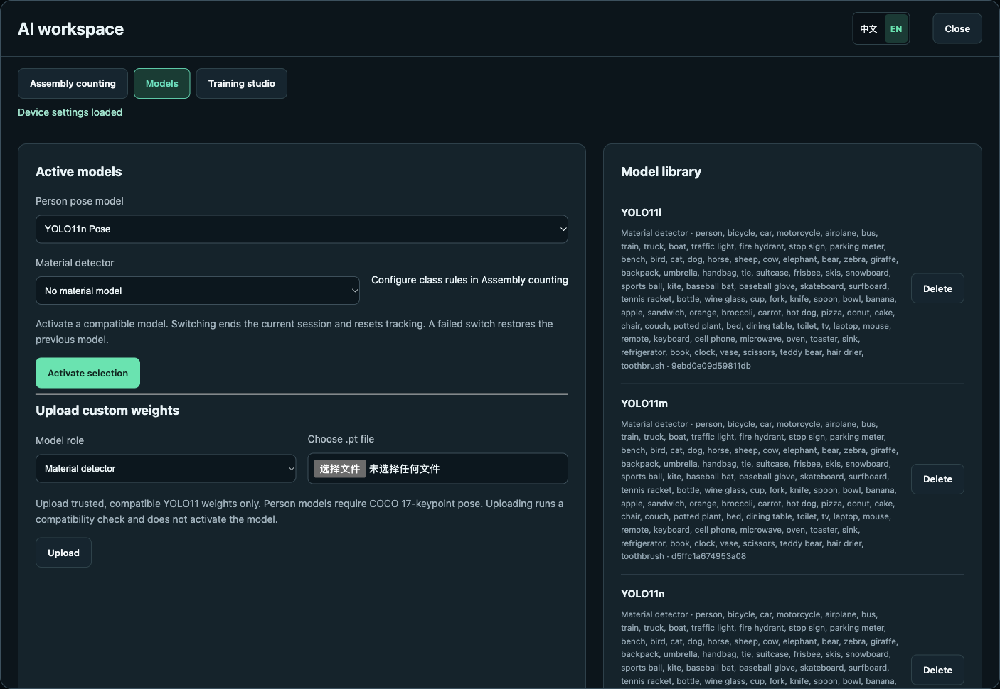
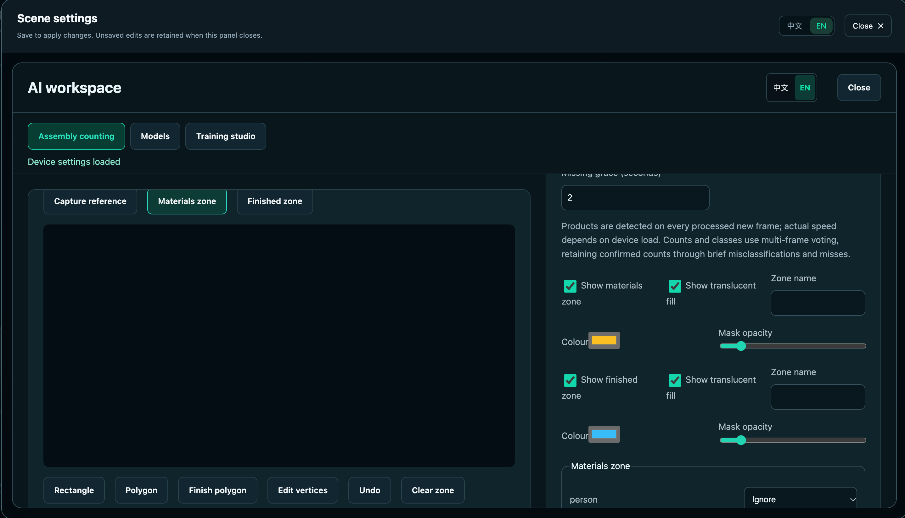

# Workstation Time and Material Monitoring

## What This Solution Does

Monitor operator worktime and material counts at production workstations using computer vision. Collect and annotate on-site images, manage models and train them locally to adapt monitoring to the workstation. The application ships as a ready-to-run pinned image: pull online or import offline, with no compilation or dependency installation on first launch.

## Core Value

### Connect your own camera

Connect an IP or PoE camera using its RTSP URL, or select a USB camera connected to your Jetson. Test the connection, then save to switch the video source.

### Upload your own detection model

Upload a compatible YOLO detection model (.pt), review its class labels, and activate it for material counting.

### Customize detection regions

Draw rectangular or polygonal regions, adjust their vertices, and define separate areas for materials and finished products to match your workstation layout.

## Use Cases

Production workstations and assembly or packing seats where operator worktime and material flow need to be tracked. Count materials and finished products separately per region, collect on-site images, and train a site-specific detection model when the preinstalled models do not fit your parts.

## Hardware Requirements

| Item | Requirements & behavior |
|---|---|
| **Recommended host** | reComputer J40 (Orin NX 8GB / 16GB) or reComputer J30 (Orin Nano 8GB) |
| **System baseline** | Ubuntu **22.04** · L4T **36.4.3** · Kernel `5.15.148-tegra` |
| **Prerequisites** | Docker · Compose v2 · NVIDIA Container Runtime |
| **Camera input** | IP / PoE camera via RTSP, or a local USB camera |
| **Persistent data** | Configuration, datasets, models and training outputs stay outside the container |

Other **reComputer J40 / J30 series** devices running **JetPack 6.2** are also supported when they meet the same hardware and system baseline.

> **First launch:** No camera required. Privacy mode is on, and YOLO11 detection and pose weights are included for offline use.

**Validation:** Hardware-verified on Orin NX 16GB (reComputer Industrial J40). Other baseline-compatible modules use the same pinned image; run the built-in GPU check after deployment.

## Usage Notes

- **Upgrades:** Finish or pause training first. A failed release restores the previous configuration, database and services; keep separate data backups.
- **Network:** Use a trusted LAN. Remote access requires an authenticated HTTPS gateway.
- **Licensing:** Review the applicable Ultralytics license before redistribution or commercial use.