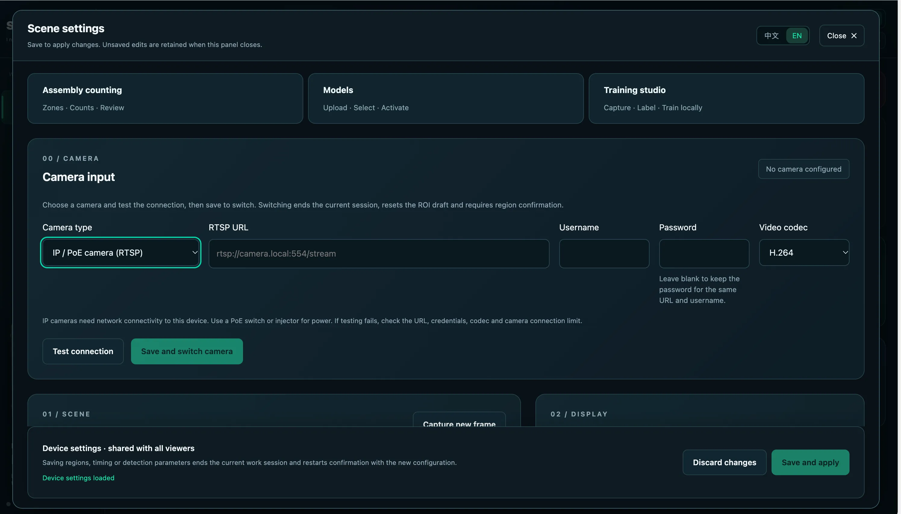
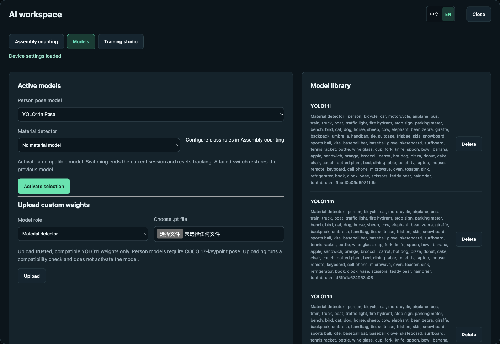
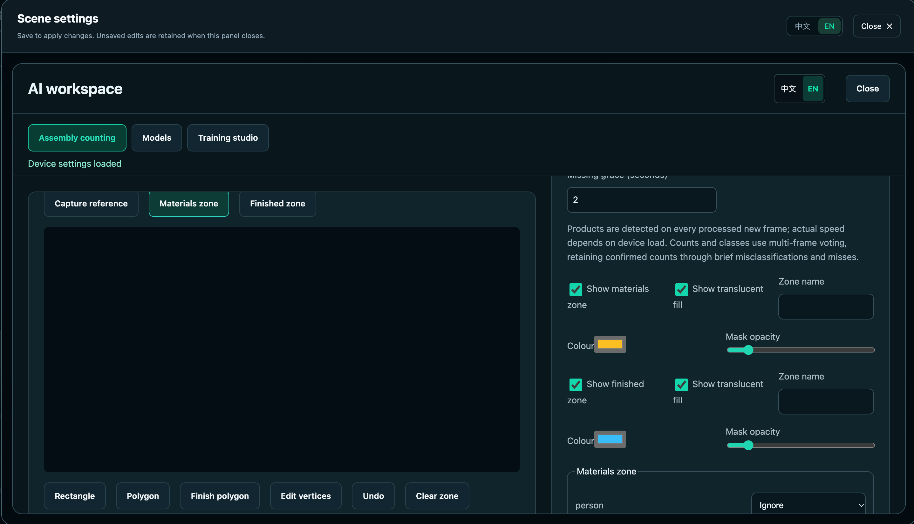

# 生产工位工时与物料监测

## 这个方案能帮你做什么

面向生产工位，通过视觉统计人员作业工时、监测物料数量，并支持现场数据采集、标注与模型训练，便于根据工位实际情况调整监测模型。应用以固定镜像交付，即装即用：支持在线拉取或离线导入，首次启动无需编译或安装项目依赖。

## 核心价值

### 接入自己的摄像头

填写网络 / PoE 摄像头的 RTSP 地址，或选择连接到 Jetson 的 USB 摄像头。测试连接后保存，即可切换视频来源。

### 上传自己的检测模型

上传兼容的 YOLO 检测模型（.pt），查看模型类别标签，并启用该模型进行物料计数。

### 自定义检测区域

绘制矩形或多边形区域，拖动顶点调整边界，并为物料和成品分别设置检测范围，适配实际工位布局。

## 适用场景

需要跟踪人员作业工时与物料流转的生产工位、装配或包装席位。按区域分别统计物料与成品数量，采集现场图像，并在预置模型不适配你的零件时训练工位专属检测模型。

## 硬件要求

| 项目 | 要求与行为 |
|---|---|
| **推荐主机** | reComputer J40（Orin NX 8GB / 16GB）或 reComputer J30（Orin Nano 8GB） |
| **系统基线** | Ubuntu **22.04** · L4T **36.4.3** · 内核 `5.15.148-tegra` |
| **预装环境** | Docker · Compose v2 · NVIDIA Container Runtime |
| **相机接入** | RTSP 网络 / PoE 摄像头，或本地 USB 摄像头 |
| **数据保留** | 配置、数据集、模型与训练产物保存在容器外 |

其他运行 **JetPack 6.2** 的 **reComputer J40 / J30 系列**，在满足相同硬件与系统基线时同样支持。

> **首次启动：** 无需预先接入相机；隐私模式默认开启，已预置可离线使用的 YOLO11 检测与姿态权重。

**验证范围：** 已在 Orin NX 16GB（reComputer Industrial J40）真机验证；满足上述基线的其他模组使用同一固定镜像，部署后请运行内置 GPU 检查，详见[验证记录](docs/validation.md)。

## 使用须知

- **升级维护：** 先完成或暂停训练；发布失败会恢复原配置、数据库与服务，重要数据仍需单独备份。
- **网络访问：** 在可信局域网中使用；远程访问需配置带身份认证的 HTTPS 网关。
- **许可条件：** 再分发或商业使用前，请确认适用的 Ultralytics 许可。